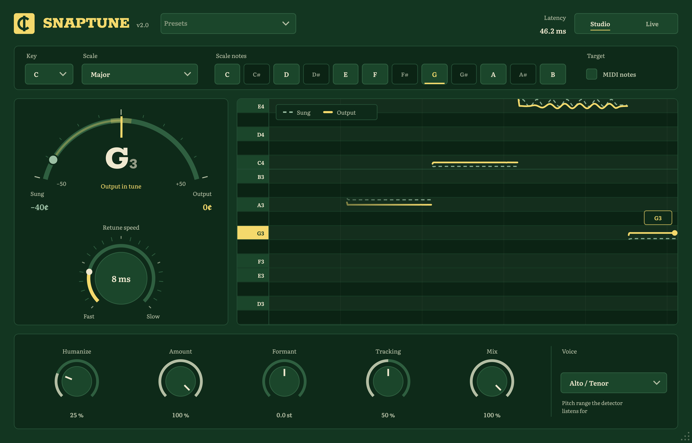

# SnapTune

[](https://github.com/NicoFerni/snaptune/actions/workflows/build.yml)
[](https://github.com/NicoFerni/snaptune/releases/latest)
[](LICENSE)

**Open-source real-time pitch correction for your DAW.** From the robotic hard-tune snap to
transparent correction, with a formant-preserving Studio mode and a 2.7 ms Live mode for tracking.
VST3 + Audio Unit, macOS (Apple Silicon and Intel).



## Features

- **Hard tune to natural:** Retune Speed from 0 ms (instant snap, the T-Pain sound) to slow, vibrato-friendly correction, plus Humanize for long notes
- **Formant-preserving:** pitch moves, your voice's character doesn't (no chipmunk). A Formant knob shifts it on purpose
- **Studio and Live modes:** 46 ms formant-safe processing for mixing (compensated by the DAW), or 2.7 ms for hearing yourself tuned while recording. Switch any time; the DAW is told the new latency automatically
- **Key and scale:** 13 scales, or click the note pills to build your own
- **MIDI target notes:** play or draw a melody and the voice follows it
- **See what it's doing:** a tuner gauge (where you sang vs. where it lands) and a piano-roll pitch graph
- **Factory presets:** Hard Tune, Melodic Trap, Natural, Subtle Polish, Deep Robot, Bright Pop
- Resizable window (70 % to 150 %), tooltips on every control, under 1 % CPU

## Download

Grab **SnapTune-…-macOS.zip** from the [latest release](https://github.com/NicoFerni/snaptune/releases/latest)
(VST3, Audio Unit and a standalone app; universal for Apple Silicon and Intel, macOS 11+):

1. Copy `SnapTune.vst3` to `~/Library/Audio/Plug-Ins/VST3/` and `SnapTune.component` to `~/Library/Audio/Plug-Ins/Components/`.
2. The builds aren't notarized by Apple, so clear the download quarantine once:
   ```sh
   xattr -dr com.apple.quarantine ~/Library/Audio/Plug-Ins/VST3/SnapTune.vst3 ~/Library/Audio/Plug-Ins/Components/SnapTune.component
   ```
3. Restart your DAW and rescan plugins.

## Build from source

Takes about two minutes:

```sh
brew install cmake ninja          # plus Xcode or the Xcode command-line tools
git clone https://github.com/NicoFerni/snaptune.git && cd snaptune
cmake -B build -G Ninja -DCMAKE_BUILD_TYPE=Release
cmake --build build --target SnapTune_VST3 SnapTune_AU SnapTune_Standalone
```

JUCE 9.0.4 is downloaded automatically during the first configure. The build installs
`SnapTune.vst3` to `~/Library/Audio/Plug-Ins/VST3` and `SnapTune.component` to
`~/Library/Audio/Plug-Ins/Components`; then rescan plugins in your DAW. `SnapTune.app` (Standalone,
in `build/SnapTune_artefacts/Release/Standalone`) lets you try it with a microphone, no DAW needed;
use headphones.

## Quick start (FL Studio)

1. **Options > Manage plugins > Find installed plugins**, then load SnapTune on the vocal's mixer insert.
2. Set **Key** and **Scale** to the song (Chromatic if you don't know it).
3. Pick a preset: **Hard Tune** for the robotic effect, **Melodic Trap** for tight modern vocals, **Natural** for invisible correction.
4. Set **Voice** to match the singer (Low Male for deep voices).
5. Use **Live** while recording and **Studio** when mixing.

**MIDI target notes in FL Studio:** in SnapTune's wrapper (gear icon) set *MIDI input port* to a free
number, add a **MIDI Out** channel on the same port, write the melody in its piano roll, and turn on
**MIDI notes**. While notes are held the voice is tuned to them (any octave); otherwise it uses the scale.

## Controls

| Control | What it does |
| --- | --- |
| Presets | Starting points for the correction knobs. Key, scale and voice are left alone. |
| Studio / Live | Studio: TD-PSOLA, formant-safe, 46 ms. Live: delay-line resampling, 2.7 ms (Formant is inactive). |
| Key / Scale | The notes the voice may land on. |
| Scale notes | Lit = in the scale, solid = the note being tuned to now, violet dot = held MIDI note. Click to toggle. |
| MIDI notes | Tune to held MIDI notes instead of the scale. |
| Retune Speed | Time to reach the note. 0 ms = instant (hard tune); slower keeps slides and vibrato. |
| Humanize | Relaxes the correction on sustained notes. |
| Amount | How much of the pitch error is corrected. |
| Formant | Shifts the vocal character ±5 semitones without changing pitch (Studio only). |
| Tracking | Higher treats breathy or noisy singing as pitched; lower is stricter. |
| Mix | Dry/wet, latency-aligned. |
| Voice | Detection range: Soprano 110–1400 Hz, Alto/Tenor 75–1000 Hz, Low Male 65–600 Hz, Instrument 65–1600 Hz. |
| Pitch graph | The note range stays still while you sing. Scroll or drag to move it (it then stays put); double-click to follow the singer again. |

## Troubleshooting

- **The graph shows only dots, or nothing gets corrected.** SnapTune needs the vocal on its own: put it on
  the vocal's mixer track, not on the beat or the master. If the voice is breathy or the room is
  live, raise **Tracking**; for deep voices choose **Voice: Low Male**.
- **An update doesn't show up.** Your DAW keeps the old plugin loaded until it restarts: quit it
  completely and open it again after rebuilding.

## How it works

1. **Pitch detection: YIN** (de Cheveigné & Kawahara, 2002). Every 2.7 ms the plugin computes the
   squared-difference function `d(τ) = Σ (x[j] − x[j+τ])²` over the newest audio, normalises it by its
   running mean (the CMNDF, which removes the zero-lag bias of plain autocorrelation), and takes the
   *first* dip below an absolute threshold. Taking the first dip rather than the deepest avoids octave
   errors, and parabolic interpolation gives sub-sample accuracy (< 0.1 cent on steady tones). `d(τ)` is
   computed with FFT cross-correlation plus prefix sums: three real FFTs per analysis. The original
   Auto-Tune (US patent 5,973,252) also detects pitch by autocorrelation.
2. **Note selection.** The detected pitch is snapped to the nearest allowed note, with 0.12 semitone
   hysteresis so a voice halfway between two notes doesn't flicker.
3. **Retune speed.** The correction (target − detected) passes through a one-pole smoother whose time
   constant is a third of the retune time. At 0 ms it jumps instantly (the stair-step effect); slower
   settings act like a high-pass on the pitch curve, so vibrato passes through while drift is corrected.
4. **Studio mode: TD-PSOLA.** Pitch marks are placed one period apart, locked to the same waveform peak
   in every cycle. Two-period grains (asymmetric Hann windows) centred on the marks are overlap-added at
   the corrected spacing. Because grains are re-spaced rather than resampled, the formants stay put.
   Unpitched sounds pass through untouched. Grains need to see past the note they rebuild: for the
   lowest note (65 Hz) that is 3 × 15.4 ms = 46 ms, reported to the host for compensation.
5. **Live mode: pitch-synchronous resampling** (the original Auto-Tune method). The input is read through
   a delay line at the corrected speed; when the read point drifts a full cycle it jumps back or forward
   exactly one period (found by cross-correlation, crossfaded), so the delay stays under one period.
   With no look-ahead, it analyses a shorter window and extrapolates the correction across the detector's
   delay so vibrato is still caught. Formants move with the correction, which is inaudible for ±1
   semitone tuning, so use Studio for big MIDI jumps.

## Project layout

```
Source/dsp/     PitchDetector (YIN) and AutoTuneEngine (both modes); no UI code
Source/ui/      LookAndFeel, tuner gauge, pitch graph, note pills, main view
Source/         plugin processor, parameters, presets, editor shell
tests/          offline test runner (DSP suite, plugin host test, file processing, UI snapshots)
packaging/      install notes and release text shipped with each release
.github/        CI: builds, tests and packages every push; tags publish a release
```

## Releasing

Bump `project(SnapTune VERSION x.y.z)` in `CMakeLists.txt` (and `versionText` in `Source/ui/MainView.cpp`),
commit, then push a matching tag: `git tag vx.y.z && git push origin vx.y.z`. CI builds and tests it,
then publishes the zip on the Releases page.

## Tests

```sh
cmake --build build --target SnapTuneTests
./build/SnapTuneTests_artefacts/Release/SnapTuneTests --out build/demo        # DSP suite + demo WAVs
./build/SnapTuneTests_artefacts/Release/SnapTuneTests --host ~/Library/Audio/Plug-Ins/VST3/SnapTune.vst3
./build/SnapTuneTests_artefacts/Release/SnapTuneTests --process in.wav out.wav --key A --scale Minor --retune 0 --mode live
./build/SnapTuneTests_artefacts/Release/SnapTuneTests --snapshot docs/screenshot.png
auval -v aumf Snpt Ncfz
```

The suite renders a synthetic singer (band-limited glottal source through formant resonators) singing an
off-key melody and checks, with an independent pitch tracker, that in both modes:
- notes land within 1 cent
- retune speed keeps or removes vibrato as intended
- scales, fast glides and MIDI targets snap correctly
- formants stay in place
- unpitched audio passes through bit-exact
- low voices work, splices stay clean, and mode switching is safe
- output doesn't depend on block size, and CPU stays low

The host test loads the built VST3/AU, and checks that switching mode while running tells the host the new latency.

## License

SnapTune is free software under the [GNU Affero General Public License v3.0](LICENSE). It is built
with [JUCE](https://juce.com), used under the same AGPLv3 terms. "Auto-Tune" is a trademark of Antares
Audio Technologies; SnapTune is not affiliated with Antares.

## References

- A. de Cheveigné, H. Kawahara, "YIN, a fundamental frequency estimator for speech and music", JASA 111(4), 2002
- H. Hildebrand, US patent 5,973,252, "Pitch detection and intonation correction apparatus and method"
- E. Moulines, F. Charpentier, "Pitch-synchronous waveform processing techniques for text-to-speech synthesis using diphones", Speech Communication 9, 1990
- P. McLeod, G. Wyvill, "A smarter way to find pitch", ICMC 2005
